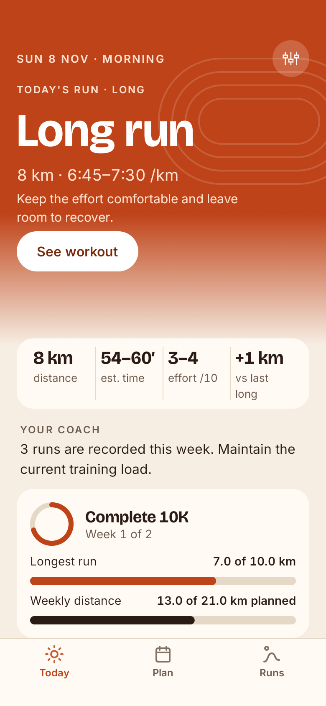
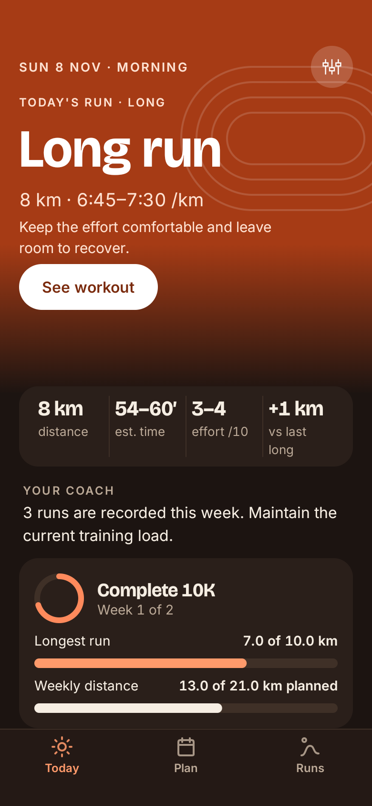
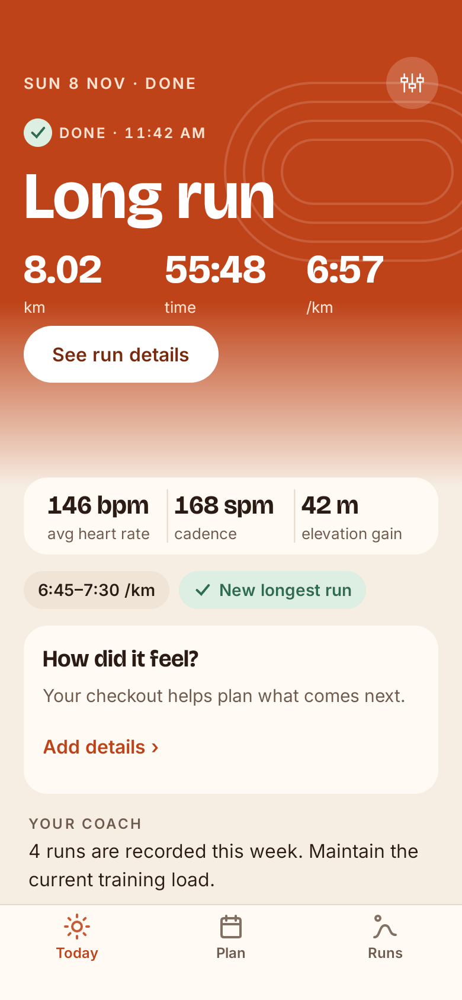
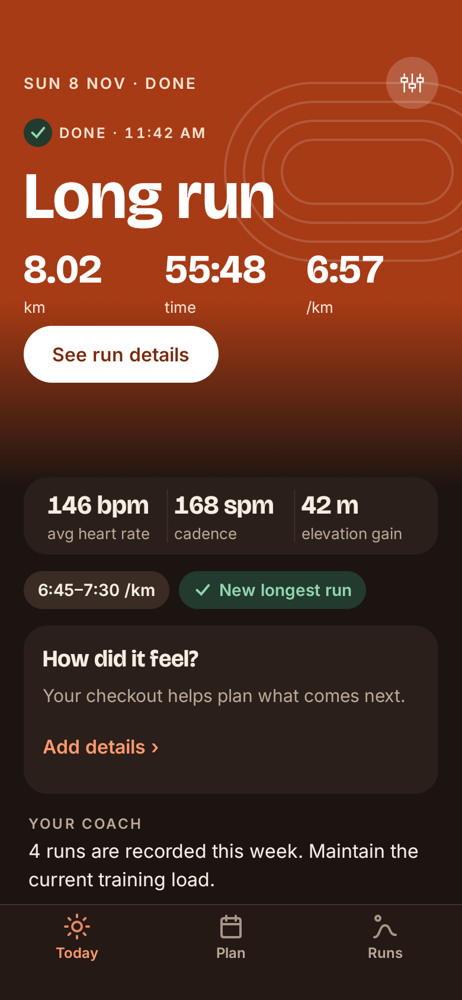
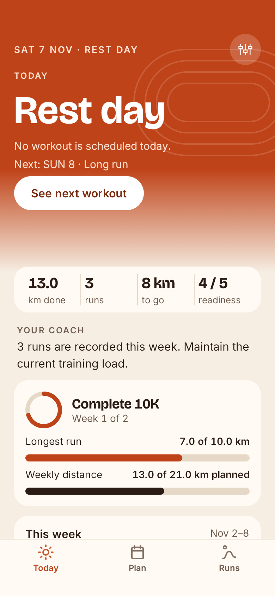
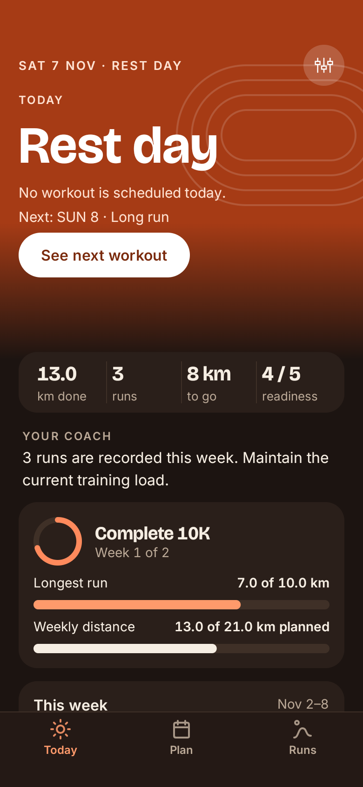

# Today Step 4: preview captures

Unedited Compose-root captures on the Android 17 emulator at 390 × 844 dp. All data is synthetic and debug-only. Normal-font captures preserve the full scroll as sequential viewport pages. The large-font images show the first viewport; automated checks also scroll through the remaining content.

After-run quick facts deliberately differ from the PNG: no duplicate hero km/time/pace, only complementary sourced facts. The preview has no checkout, so effort-vs-plan is unknown and omitted, leaving three equal columns. Rest-day facts use the PNG labels.

| State | Light, 100% | Dark, 100% |
|---|---|---|
| Before run | [Page 1](today-beforerun-light-100-page-1.png) · [Page 2](today-beforerun-light-100-page-2.png) · [Page 3](today-beforerun-light-100-page-3.png) | [Page 1](today-beforerun-dark-100-page-1.png) · [Page 2](today-beforerun-dark-100-page-2.png) · [Page 3](today-beforerun-dark-100-page-3.png) |
| After run | [Page 1](today-afterrun-light-100-page-1.png) · [Page 2](today-afterrun-light-100-page-2.png) · [Page 3](today-afterrun-light-100-page-3.png) | [Page 1](today-afterrun-dark-100-page-1.png) · [Page 2](today-afterrun-dark-100-page-2.png) · [Page 3](today-afterrun-dark-100-page-3.png) |
| Rest day | [Page 1](today-restday-light-100-page-1.png) · [Page 2](today-restday-light-100-page-2.png) · [Page 3](today-restday-light-100-page-3.png) | [Page 1](today-restday-dark-100-page-1.png) · [Page 2](today-restday-dark-100-page-2.png) · [Page 3](today-restday-dark-100-page-3.png) |

| State | Light, 130% | Dark, 130% | Light, 200% | Dark, 200% |
|---|---|---|---|---|
| Before run | [Capture](today-beforerun-light-130-page-1.png) | [Capture](today-beforerun-dark-130-page-1.png) | [Capture](today-beforerun-light-200-page-1.png) | [Capture](today-beforerun-dark-200-page-1.png) |
| After run | [Capture](today-afterrun-light-130-page-1.png) | [Capture](today-afterrun-dark-130-page-1.png) | [Capture](today-afterrun-light-200-page-1.png) | [Capture](today-afterrun-dark-200-page-1.png) |
| Rest day | [Capture](today-restday-light-130-page-1.png) | [Capture](today-restday-dark-130-page-1.png) | [Capture](today-restday-light-200-page-1.png) | [Capture](today-restday-dark-200-page-1.png) |

| Before run · light | Before run · dark |
|---|---|
|  |  |

| After run · light | After run · dark |
|---|---|
|  |  |

| Rest day · light | Rest day · dark |
|---|---|
|  |  |
