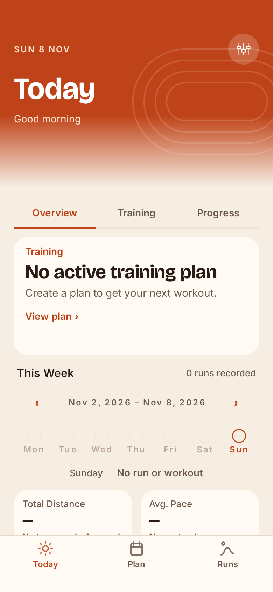
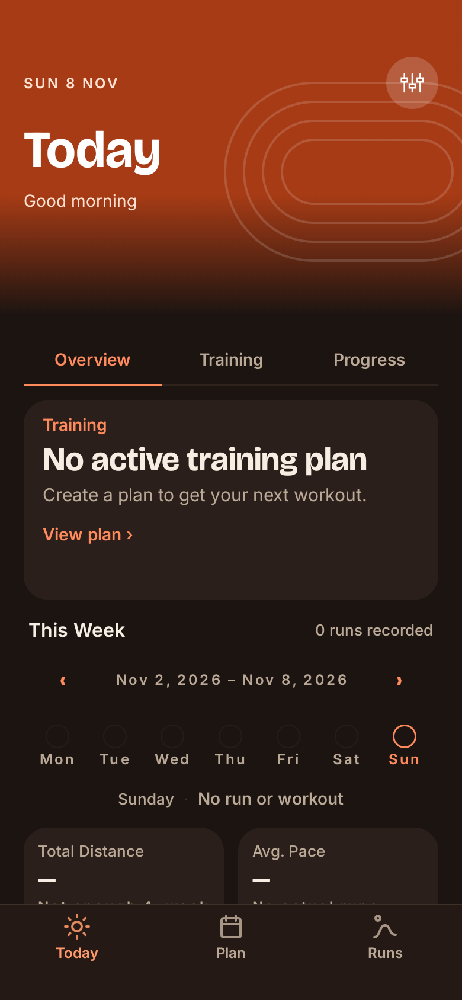

# Step 3: navigation shell verification

Scope: redesign spec sections 4 and 9, Step 3. The bottom bar contains Today (`home`), Plan (`plan`) and Runs (`history`) in that order. Settings remains `settings`, reached from the 44 dp icon button in the temporary Today hero. The bar is absent on every other route. Existing destination strings and behavior remain available.

The hero background extends under the status bar, with inset padding inside the hero and light status-bar icons in both themes. Other existing screens retain status-bar content insets. `run-checkout?runId=` is a presentation stub with a back link and a button opening the existing run-details checkout. No feedback persistence, ViewModel, domain, database or provider behavior changed.

## Automated checks

Run on 2026-11-09 after the final source/test changes:

| Command | Actual result |
|---|---|
| `./gradlew test --rerun-tasks` | Passed, 15 s; 28 actionable tasks executed; 544 tests in 56 suites, zero failures/errors/skips. |
| `./gradlew assembleDebug --rerun-tasks` | Passed, 15 s; 39 actionable tasks executed. |
| `ANDROID_SERIAL=emulator-5554 ./gradlew connectedDebugAndroidTest -Pandroid.testInstrumentationRunnerArguments.class=com.example.openruncoach.ui.navigation.NavigationShellTest` | Passed, 13 s; all 3 instrumentation tests passed. |
| `git diff --check` | Passed. |

Core CI was not run: this change touches presentation and navigation only; the isolated Core CI build compiles domain code and does not cover this scope. The full Android checks above did run. Existing Kotlin annotation-target/deprecation warnings remain warnings.

## Emulator verification

Status: **Passed** on `Medium_Phone_API_37.0`, Android 17, `emulator-5554`, 390 × 844 dp at density 2. Physical phone verification: **Pending**, not performed.

The instrumentation test uses the actual `MainNavigation` and destination screens with an isolated in-memory Room database and fixed clock. It does not use the owner's application database or health records.

- Light and dark cases assert the three tab labels, Settings click, hidden bar in Settings, back navigation, and Plan/Runs/Today tab clicks.
- Both themes assert light status-bar icon mode via `WindowInsetsControllerCompat`.
- The route sweep opens `home`, `plan`, `history`, `settings`, `performance-profile`, `goal`, `workout-preview`, `planned-workout?workoutId=`, `run?runId=`, `data-inspector?runId=`, `coach?runId=`, `simulator`, and `run-checkout?runId=`. Missing fixture IDs exercise existing empty states without inventing run records. The test asserts that only the three tab routes show the bar.
- The checkout stub's button successfully opens the existing run-details route.

An initial screenshot attempt using `UiAutomation.takeScreenshot()` failed with a disconnected capture service. Capture now uses Compose `captureToImage()`; all three final instrumentation tests pass. The same class was then run directly with `adb -s emulator-5554 shell am instrument -w -e class com.example.openruncoach.ui.navigation.NavigationShellTest com.example.openruncoach.test/androidx.test.runner.AndroidJUnitRunner`: **OK (3 tests)**, 7.879 s, to preserve and pull the PNGs after capture.

## Screenshots and reference comparison

These are unedited Compose-root captures of the running navigation shell, not generated mockups. They include the edge-to-edge content/insets; OS status-bar glyphs are outside the Compose capture. Icon appearance is checked separately by instrumentation.

| Light | Dark |
|---|---|
|  |  |

Compared against `UI/redesign/Today · before run · light.png` and `Today · before run · dark.png` for the Step 3 scope: Today/Plan/Runs order, outline sun/calendar/route icons, accent active tab, muted inactive tabs, themed flat bar with divider, and circular Settings entry on the fading hero. The existing Today body remains transitional; the state-aware Today composition is Step 4. No Step 3 spec/PNG conflict was found.
