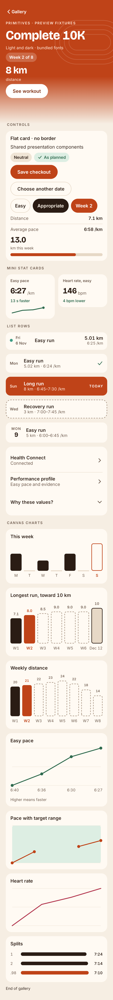
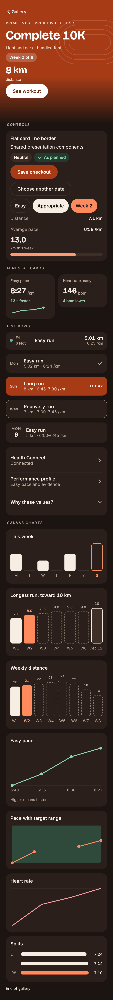

# Step 2: shared primitives and Canvas charts

Implements the requested shared primitives from redesign spec §3, building on merged Step 1 (#52) on `docs/redesign-spec`. Navigation shell integration and existing screen composition are untouched. No domain logic, ViewModel behavior, repositories, provider models, routes or database fields changed.

## Shared implementation

Existing components in `ui/components/AppVisuals.kt` were evolved directly:

| Spec concept | Shared implementation |
|---|---|
| Card | `OpenRunCard`: 20 dp radius, 16 dp padding, 10 dp gap, no border, zero elevation |
| SectionLabel | `OpenRunSectionHeader`: muted eyebrow typography and section spacing, existing trailing slot retained |
| Chip | `OpenRunStatusChip`: Neutral, Positive/Good and OnHero; existing warning/error support retained |
| Primary / secondary button | `OpenRunPrimaryButton` / `OpenRunSecondaryButton`, hero/white primary and ink/line secondary |
| Metric | `OpenRunMetric`, with hero/normal typography and colors |
| KeyValueRow | `OpenRunEvidenceRow`: 15 sp label/value, semibold tabular value, optional divider, stacked layout when needed |
| Disclosure | `OpenRunDisclosure` now reuses the new disclosure row and preserves its local expanded state |

`HeroComponents.kt` adds `OpenRunHero` (62% hero color then fade to page background), decorative `TrackLanes`, an 8 dp-overlap body container, hero button, selectable option chip, back link, progress bar and mini stat card. Accent-selected controls use `accent/onAccent`; generic checkout-style options use `ink/bg`. The progress/bar reveal is about 500 ms on first appearance, skipped for system animation scale zero and previews.

`ListRows.kt` adds Run, Workout (done/today/future), NextUp, Settings and Disclosure variants. Rows wrap or stack at larger fonts; mini-card grids fall back to one column below the width-per-item threshold. Selected controls use selection semantics; completed/planned workout states have text/state semantics as well as color. Decorative drawings are excluded from semantics.

`Charts.kt` implements WeekBars, LongRunBars, WeeklyDistanceBars, PaceLineChart, HeartRateChart, SplitBars and Sparkline using Canvas, including Canvas text. Every chart has a required description. Missing/nonfinite line samples break paths rather than creating connections; empty chart inputs and absent mini-card values are hidden. Pace plots put faster values higher. Large-font chart labels remain readable through horizontal scrolling. No chart library or other dependency was added; new components use the existing palette and bundled type tokens.

## Split-width resolution

The Run detail reference PNG exaggerates the split-length differences compared with §3.11's proportional-speed rule. The user explicitly resolved this in favor of mathematical proportions. Spec §3.11 and the rulebook now state the same rule: fastest split fills the available track, every other fraction is `speed / fastestSpeed`. For 7:24 versus 7:10, the fraction is 430 / 444 = 0.968468… ≈ 96.8%. No minimum bar width or exaggeration is applied. PNG lengths are illustrative.

`SplitBarGeometry.kt` is a pure presentation helper used by the actual drawing path. Its three JVM tests cover the 96.8% example, fastest = 100%, and zero/tiny/quarter-speed fractions without an artificial minimum or changed scale.

## Final automated verification

Final requested commands ran after the gallery refinements and split helper/test changes:

| Command | Actual result |
|---|---|
| `./gradlew test --rerun-tasks` | Passed: BUILD SUCCESSFUL in 18s; 28 actionable tasks executed. XML: 544 tests across 56 suites, zero failures/errors/skips. |
| `./gradlew assembleDebug --rerun-tasks` | Passed: BUILD SUCCESSFUL in 16s; 39 actionable tasks executed. |
| `ANDROID_SERIAL=emulator-5554 ./gradlew connectedDebugAndroidTest -Pandroid.testInstrumentationRunnerArguments.class=com.example.openruncoach.ui.components.ComponentsGalleryTest` | Passed before extraction of the equivalent split-width helper: 8 tests, zero failures/errors/skips; BUILD SUCCESSFUL in 17s. |
| `adb -s emulator-5554 shell am instrument -w -e class com.example.openruncoach.ui.components.ComponentsGalleryTest com.example.openruncoach.test/androidx.test.runner.AndroidJUnitRunner` | Passed against the final rebuilt app: OK (8 tests), 12.267s. Refreshed all ten raw PNG pages before app-uninstall cleanup. |
| `git diff --check` | Passed. |
| `./gradlew --no-daemon -p ci/core-tests test` | Not run: no domain changes; isolated Core CI does not compile this UI/presentation helper or its test. |

Full builds emitted existing warnings in `CompletedRunMetrics.kt` (annotation target) and `RunRouteMap.kt` (deprecated override). Initial gallery attempts exposed a missing test import and capture-harness issues (display-height cap and paragraph allocation being wider than wrap-content text). These were corrected before the passing eight-test run: captures scroll through pages, and text checks use rendered line bounds with a one-pixel float/integer rounding tolerance, rather than paragraph allocation width.

## Preview and device evidence

Status: **Passed — isolated emulator gallery verification.** Physical phone and full production-screen verification: **not performed**, outside this shared-component step.

The test activity renders the same `OpenRunComponentsGallery()` used by six Gallery `@Preview`s: light/dark × font scale 1.0, 1.3 and 2.0. It checks that the end of the gallery is reachable, descriptions are exposed and rendered text is not truncated. Two additional tests check selection/disclosure/back callbacks and missing-data suppression. It does not launch MainActivity or open repositories or health data. The emulator display overrides were restored after capture.

[All six variants and ten raw screenshot pages](UI/primitives-step-2/README.md).

Compared against the reference boards: Today (hero, mini stats, week bars), Plan (hero chips, long-run/weekly bars, workout rows), Runs (run rows and pace chart), Run detail (heart rate/splits) and checkout (buttons and option controls). The split-width disagreement was explicitly resolved above; the earlier selected-week `onAccent` resolution is retained. At larger fonts, wrapping, stacked rows, a one-column mini-card grid and horizontally scrollable charts intentionally adapt the composition. No production screen was rebuilt to resemble a board in this step.

| Light, 100% | Dark, 100% |
|---|---|
|  |  |

Step 3 has not started. Screens still contain their existing content and local styles; this PR establishes the shared components they will reuse in later steps.
