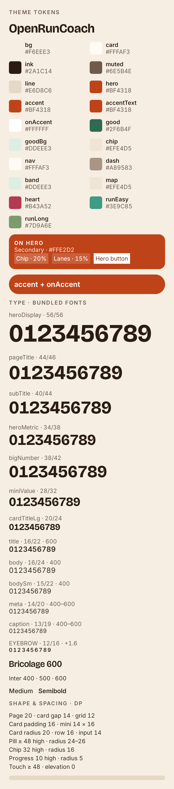
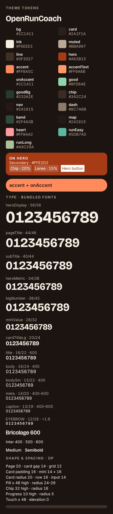

# Step 1: tokens, bundled fonts and system theme

Implements only redesign spec section 9, Step 1. The branch starts from merged Step 0 on `docs/redesign-spec`; PR #50 still owns the proposed redesign baseline relative to main. No domain, ViewModel, repository, database, app route or screen-composition changes are included.

## Implementation

- `theme/Color.kt`: immutable `OpenRunPalette`, both sets of 19 colors (including `onAccent`), hero foreground/overlay tokens and `LocalOpenRunPalette`.
- `theme/Theme.kt`: system theme default via `isSystemInDarkTheme()`, explicit theme argument retained for callers, shared Material 3 and existing chart-color mappings. Material `primary/onPrimary` use `accent/onAccent`; the palette keeps `hero/onHero` for the hero and primary-button primitives scheduled in Step 2. No dynamic wallpaper colors replace the prescribed palette.
- `theme/Type.kt`: all 13 named type styles, Material typography mappings, Bricolage Grotesque 600/700 and Inter 400/500/600, tabular figures. The five static TTF resources are bundled offline. [Font licenses, upstream revision and checksums](fonts/README.md).
- `theme/DesignTokens.kt`: existing spacing/shapes evolved to the spec's padding, gaps, radii, heights, touch target and zero elevation.
- `theme/ThemePreview.kt`: two `@Preview` configurations of one token gallery, including every redesign color, hero overlay, type style and shape/spacing value. The emulator tests render that exact composable.

Compatibility: existing `OpenRunColors` names remain aliases to the new dark palette for unmigrated callers, including non-composable map styling. This step establishes theme support; existing screens/components using those static aliases are not yet fully styled for light mode. Their scheduled migration belongs to later steps. `AppVisuals.kt` is unchanged; no parallel primitives were introduced.

## Automated verification

All commands ran from the repository root on 9 November 2026:

| Command | Actual result |
|---|---|
| `./gradlew test --rerun-tasks` | Passed: BUILD SUCCESSFUL in 38s; 28 actionable tasks executed. XML reports: 541 tests across 55 suites, zero failures/errors/skips. |
| `./gradlew assembleDebug --rerun-tasks` | Passed: BUILD SUCCESSFUL in 21s; 39 actionable tasks executed. |
| `ANDROID_SERIAL=emulator-5554 ./gradlew connectedDebugAndroidTest -Pandroid.testInstrumentationRunnerArguments.class=com.example.openruncoach.theme.ThemePreviewTest` | Passed: 3 tests, zero failures/errors/skips; BUILD SUCCESSFUL in 11s (9 tasks executed, 64 up-to-date). Only the selected theme test class ran. |
| `adb -s emulator-5554 shell am instrument -w -e class com.example.openruncoach.theme.ThemePreviewTest com.example.openruncoach.test/androidx.test.runner.AndroidJUnitRunner` | Passed again: OK (3 tests). Used the already built APKs to retain captures before Gradle's app-uninstall cleanup. |
| `git diff --check` | Passed. |
| `./gradlew --no-daemon -p ci/core-tests test` | Not run: no domain changes; the isolated core build does not compile theme/UI code. |

The first sandboxed Gradle invocation could not open the external wrapper lock; the recorded successful runs used approved cache access. Full rebuilds emitted existing warnings in `CompletedRunMetrics.kt` (annotation target) and `RunRouteMap.kt` (deprecated override). Instrumentation compilation emitted non-null assertion warnings; these did not fail verification.

Additional checks: all 38 light/dark token values matched `design-tokens.json`; FontTools verified each TTF is static, has its declared OS/2 weight and includes `tnum`. New color literals are confined to the theme package. No new runtime dependency or network font provider was added.

## Preview screenshots and device evidence

Status: **Passed — isolated emulator preview verification.** Physical-device and full-screen redesign verification: **not performed**, outside this step.

Device: `Medium_Phone_API_37.0`, Android 17 / API 37, serial `emulator-5554`. Capture configuration: width 390 dp, density 320, font scale 1.0. The Compose root capture is 780 × 3515 px; no screenshot editing or mock rendering was used. The emulator display was temporarily enlarged for the complete gallery and restored afterward. The connected physical phone was not used.

The test activity invokes `OpenRunThemeTokensPreview()` under light/dark configurations, without opening `MainActivity`, app data or health sources. The other test changes the system-night configuration and checks both the exposed palette and Material/chart roles. Captures were visually inspected: all 19 swatches, hero overlays, the `accent/onAccent` sample, all 13 styles and layout values are visible without clipping. These are token previews, not evidence that later screen redesign steps are implemented.

| Light | Dark |
|---|---|
|  |  |

Studio rendering was unavailable because no Android Studio instance was running. The emulator captures show the same preview composable with the real bundled fonts.

## Remaining scope

Step 1 is complete. Step 2 (shared primitives) has not started. Full screen styling and font-scale accessibility checks remain with their scheduled redesign steps.
